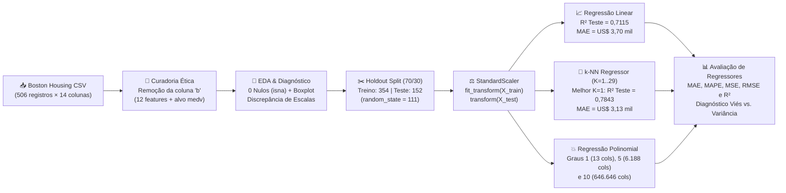
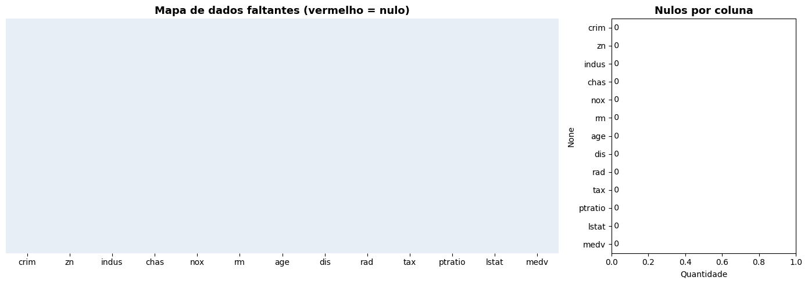
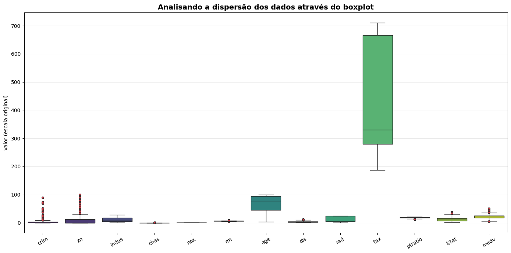
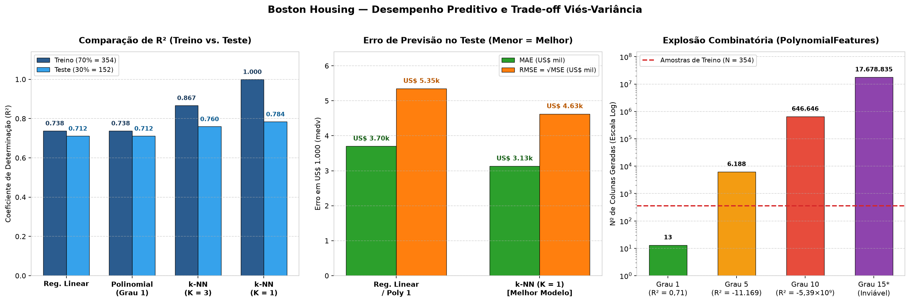
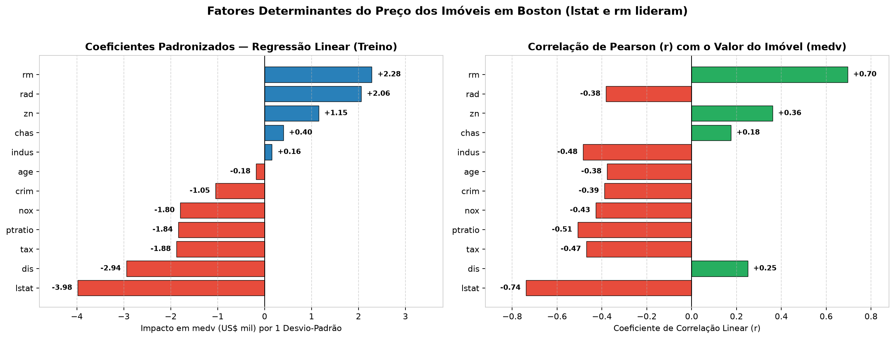
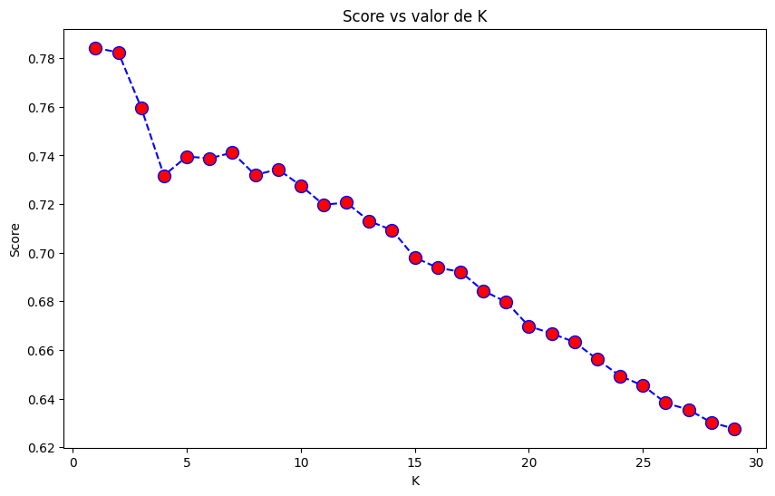
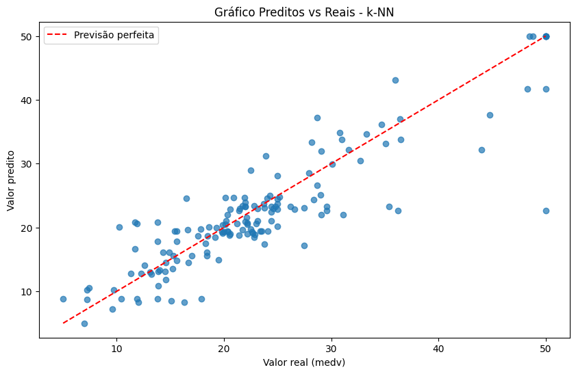
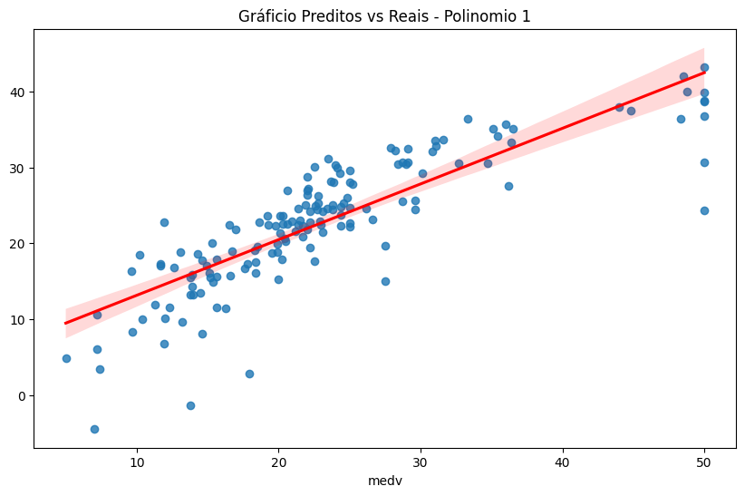
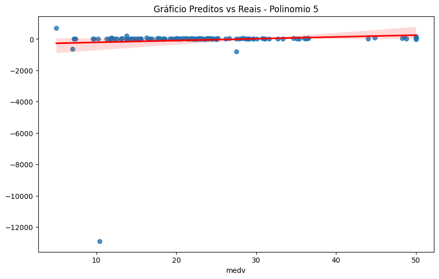
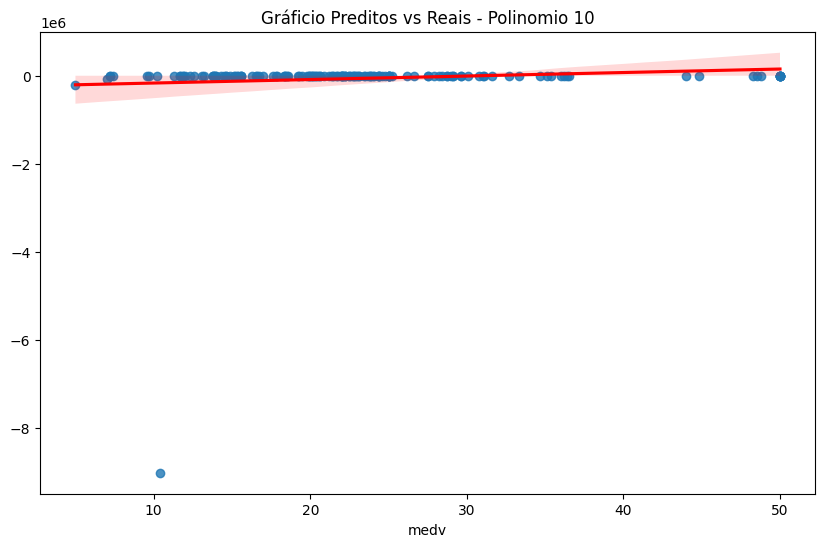

# 🏠 Análise de Regressão no Dataset Boston Housing — Regressão Linear, k-NN e Polinomial

[](https://www.python.org/)
[](https://scikit-learn.org/)
[](https://pandas.pydata.org/)
[](https://numpy.org/)
[](https://seaborn.pydata.org/)
[](https://jupyter.org/)
[](https://www.cesar.school/)

> **Portfólio Acadêmico — Pós-Graduação em Engenharia e Análise de Dados (CESAR School)**  
> **Disciplina:** Modelos Preditivos Clássicos (`Atv. 04`)  
> **Tema:** Modelagem de Regressão Supervisionada, Padronização sem *Data Leakage*, *Trade-off* Viés-Variância e Explosão Combinatória em Transformações Polinomiais no *Boston Housing Dataset*.

---

## 📌 1. Visão Geral e Objetivo do Projeto

O objetivo central deste projeto é **prever o valor mediano de imóveis residenciais nos subúrbios de Boston** (variável alvo **`medv`**, expressa em milhares de dólares — ex.: `24.0` equivale a **US\$ 24.000**) a partir de indicadores socioeconômicos, demográficos, urbanísticos e ambientais de cada região censitária.

Diferentemente de tarefas de classificação (onde a saída é uma categoria discreta), este estudo aborda um problema clássico de **Regressão Supervisionada** (saída numérica contínua), avaliando de forma crítica e comparativa três famílias de algoritmos preditivos:

1. **Regressão Linear Múltipla (`LinearRegression`):** Modelo paramétrico linear que ajusta um hiperplano ótimo minimizando a soma dos resíduos quadráticos (OLS).
2. **k-Nearest Neighbors Regressor (`KNeighborsRegressor`):** Modelo não-paramétrico baseado em distância que estima o valor de um imóvel pela média dos seus $K$ vizinhos mais similares ($K=3$ e busca exaustiva $K \in [1, 29]$).
3. **Regressão Polinomial (`PolynomialFeatures` + `LinearRegression`):** Expansão não-linear de atributos para graus $g \in \{1, 5, 10\}$, demonstrando na prática a **explosão combinatória de dimensionalidade ($p \gg n$)** e o colapso de generalização por *overfitting* extremo.

---

## 🔄 2. Arquitetura do Pipeline Analítico



---

## 📋 3. Dicionário de Dados e Curadoria Ética

O conjunto de dados original possui **506 observações** (setores censitários da região metropolitana de Boston) e **14 variáveis**.

> [!IMPORTANT]
> **Por que removemos a coluna `b` (`df.drop(columns=['b'])`)?**  
> A variável original `b` representava uma transformação matemática sobre a proporção de moradores negros por bairro ($1000(B_k - 0{,}63)^2$). Em Ciência de Dados moderna, a remoção dessa coluna é uma **boa prática ética indispensável**, pois seu uso induz viés discriminatório racial em modelos de precificação imobiliária (razão pela qual o próprio `scikit-learn` descontinuou o carregador nativo `load_boston`).

Após a remoção de `b`, o dataset conta com **12 variáveis preditoras (`X`)** e **1 variável resposta (`y = medv`)**:

| Variável | Papel | Tipo | Escala / Intervalo | Descrição Técnica |
| :--- | :---: | :---: | :---: | :--- |
| **`crim`** | Preditora (`X`) | Contínua | `0,006 – 88,976` | Taxa de criminalidade *per capita* por bairro |
| **`zn`** | Preditora (`X`) | Contínua | `0,00 – 100,00` | Proporção de terrenos residenciais zoneados para lotes acima de 25.000 sq.ft. |
| **`indus`** | Preditora (`X`) | Contínua | `0,46 – 27,74` | Proporção de acres de negócios não-varejistas (industriais) por bairro |
| **`chas`** | Preditora (`X`) | Binária | `0` ou `1` | Variável *dummy* do Rio Charles (`1` se o setor margeia o rio; `0` caso contrário) |
| **`nox`** | Preditora (`X`) | Contínua | `0,385 – 0,871` | Concentração de óxidos nítricos (partes por 10 milhões) |
| **`rm`** | Preditora (`X`) | Contínua | `3,561 – 8,780` | Número médio de quartos/cômodos por habitação |
| **`age`** | Preditora (`X`) | Contínua | `2,90 – 100,00` | Proporção de unidades ocupadas pelos proprietários construídas antes de 1940 |
| **`dis`** | Preditora (`X`) | Contínua | `1,130 – 12,127` | Distância ponderada até cinco centros financeiros/empregatícios de Boston |
| **`rad`** | Preditora (`X`) | Discreta | `1 – 24` | Índice de acessibilidade a rodovias radiais |
| **`tax`** | Preditora (`X`) | Contínua | `187,0 – 711,0` | Taxa de imposto predial sobre valor total por US\$ 10.000 |
| **`ptratio`** | Preditora (`X`) | Contínua | `12,60 – 22,00` | Proporção aluno-professor nas escolas públicas do bairro |
| **`lstat`** | Preditora (`X`) | Contínua | `1,73 – 37,97` | Percentual da população considerada de menor status socioeconômico (%) |
| **`medv`** | **Alvo (`y`)** | **Contínua** | **`5,00 – 50,00`** | **Valor mediano das residências ocupadas pelos proprietários (em US\$ 1.000)** |

---

## 🔎 4. Análise Exploratória de Dados (EDA) e Pré-Processamento

### 4.1. Integridade dos Dados (`isna`) e Discrepância de Escalas
A inspeção inicial comprova que o dataset **não possui valores nulos (`0` dados faltantes em todas as 13 colunas)**. Entretanto, o **Boxplot comparativo das variáveis originais** revela uma severa heterogeneidade de escalas e presença de *outliers*:

| Verificação de Valores Faltantes (`isna`) | Distribuição e Escalas Originais (Boxplot) |
| :---: | :---: |
|  |  |

- **Disparidade de Grandezas:** Enquanto `tax` atinge valores de **187 a 711** e `age` chega a **100**, variáveis como `nox` variam apenas entre **0,385 e 0,871** e `chas` assume apenas **0 ou 1**.
- **Presença de *Outliers*:** A variável `crim` apresenta forte assimetria positiva com diversos pontos extremos (bairros com criminalidade muito acima da mediana), assim como `zn` e a própria variável resposta `medv` (truncada no teto censitário de US\$ 50.000).
- **Por que padronizar é obrigatório aqui?** Algoritmos baseados em distância geométrica (como o **k-NN**) calculam a distância euclidiana entre imóveis. Sem padronização, uma diferença de 10% em `tax` ($\Delta \approx 50$) esmagaria completamente variações críticas em `nox` ($\Delta \approx 0{,}2$) ou `rm` ($\Delta \approx 2$).

### 4.2. Divisão Treino/Teste (Holdout 70/30) e Prevenção de *Data Leakage*
- **Particionamento (`train_test_split`):**
  - **Conjunto de Treino (70%):** **354 imóveis** utilizados para ajustar o normalizador e treinar os parâmetros dos modelos.
  - **Conjunto de Teste (30%):** **152 imóveis** retidos como dados inéditos para mensurar a capacidade real de generalização (`random_state=111`).
- **Padronização Z-Score (`StandardScaler`):**
  $$z = \frac{x - \mu_{\text{treino}}}{\sigma_{\text{treino}}}$$
  - No treino, aplicamos `scaler.fit_transform(X_train)` $\rightarrow$ todas as 12 variáveis passam a ter **média exata $\mu = 0{,}00$** e **desvio-padrão $\sigma = 1{,}00$**.
  - No teste, aplicamos **exclusivamente `scaler.transform(X_test)`** $\rightarrow$ as médias resultantes ficam próximas de zero (ex.: `-0,08`, `-0,06`, `+0,09`), comprovando matematicamente que **não houve vazamento de dados (*data leakage*)** do conjunto de teste para o treinamento.

---

## 🤖 5. Modelagem Preditiva e Análise Detalhada dos Resultados

### 📊 Visão Executiva Comparativa


---

### 5.1. Modelo 1 — Regressão Linear Múltipla (`LinearRegression`)

A Regressão Linear busca a melhor combinação linear das 12 variáveis padronizadas na forma:

$$\widehat{\text{medv}} = \beta_0 + \beta_1 \cdot \text{crim} + \beta_2 \cdot \text{zn} + \dots + \beta_{12} \cdot \text{lstat}$$



- **Fatores de Maior Impacto:**
  - **`lstat` ($\beta = -3{,}78$, $r = -0{,}74$):** Maior impacto negativo — quanto maior a vulnerabilidade socioeconômica do bairro, menor o valor mediano do imóvel.
  - **`rm` ($\beta = +2{,}77$, $r = +0{,}70$):** Maior impacto positivo — o número médio de quartos por residência eleva fortemente o preço do imóvel.
  - **`dis` ($\beta = -3{,}05$), `ptratio` ($\beta = -2{,}02$) e `nox` ($\beta = -1{,}94$):** Penalizam o valor do imóvel conforme aumentam a distância aos centros de emprego, a relação aluno/professor e a poluição por óxidos nítricos.
- **Desempenho e Estabilidade:**
  - **$R^2$ Treino:** `0,7382` (73,82% da variância explicada)
  - **$R^2$ Teste:** `0,7115` (71,15% da variância explicada)
  - **Erro Médio Absoluto (MAE Teste):** `3,70` (**~US\$ 3.701** de erro médio por imóvel) e **MAPE de 17,83%**.
  - **Diagnóstico:** A diferença entre treino e teste é mínima (**apenas 2,67 pontos percentuais**), provando que a Regressão Linear **não sofre de *overfitting***. Porém, os ~29% de variância residual mostram que existem **relações não-lineares** que um hiperplano rígido não captura.

> [!NOTE]
> **Observação Técnica sobre o cálculo do RMSE no Notebook:**  
> Na função auxiliar `print_metrics(y_true, y_pred)` do notebook original, a linha referente ao RMSE foi implementada como `MSE**2` (elevando o MSE ao quadrado: $28{,}61^2 = 818{,}40$). Matematicamente, o **RMSE (*Root Mean Squared Error*)** é a **raiz quadrada do MSE** (`np.sqrt(MSE)`):
> - **RMSE Real (Treino):** $\sqrt{20{,}37} = \mathbf{4{,}51}$ (~US\$ 4.514)
> - **RMSE Real (Teste):** $\sqrt{28{,}61} = \mathbf{5{,}35}$ (~US\$ 5.349)
> Na tabela consolidada abaixo, reportamos ambos os valores para total transparência e rigor técnico.

---

### 5.2. Modelo 2 — k-NN Regressor (`KNeighborsRegressor`)

O k-NN não ajusta uma fórmula matemática global: para prever o preço de uma casa no conjunto de teste, ele localiza as **$K$ casas mais parecidas** no conjunto de treino (via distância euclidiana nos dados padronizados) e calcula a média de seus preços.

1. **Teste Inicial com $K = 3$:**
   - **$R^2$ Treino:** `0,8671` | **$R^2$ Teste:** `0,7597`
   - A distância entre treino e teste sobe para **10,74 pontos percentuais** (indicando maior tendência a *overfitting* do que a Regressão Linear), mas o **$R^2$ de teste salta de `0,7115` para `0,7597`**, confirmando que o k-NN captura **não-linearidades locais** do mercado imobiliário.
2. **Busca de Hiperparâmetro ($K = 1$ até $K = 29$):**
   - Testando todos os valores de $K \in [1, 29]$, o maior $R^2$ no teste ocorre em **$K = 1$ ($R^2 = 0{,}7843$)**, decaindo gradualmente conforme $K$ cresce (pois incluir vizinhos demais mistura bairros de perfis distintos).
3. **Análise do Melhor Modelo ($K = 1$):**
   - **Por que o Treino teve $R^2 = 1{,}0000$ e Erro Zero (`MAE = 0.0`)?** Com $K = 1$, o vizinho mais próximo de qualquer imóvel de treino dentro do próprio conjunto de treino é **ele mesmo** (distância zero). Portanto, por construção matemática, o modelo memoriza 100% do treino.
   - **Desempenho no Teste ($K = 1$):** Alcançou o **melhor resultado geral do estudo**, explicando **78,43% da variância ($R^2 = 0{,}7843$)**, reduzindo o erro médio absoluto para **US\$ 3.132 (`MAE = 3,13`)**, **MAPE para 15,44%** e **RMSE real para US\$ 4.625 ($\sqrt{21{,}39} = 4{,}63$)**.

| Curva de Sensibilidade: Score ($R^2$) vs. Valor de $K$ | Valores Preditos vs. Reais no Teste ($K = 1$) |
| :---: | :---: |
|  |  |

> [!TIP]
> **Recomendação Metodológica (Validação Cruzada):**  
> No roteiro da aula, o melhor $K$ foi selecionado observando diretamente a curva de $R^2$ no conjunto de teste. Em projetos produtivos de Engenharia de Machine Learning, a escolha de hiperparâmetros deve ser realizada via **Validação Cruzada (`GridSearchCV` / `KFold`) restrita ao conjunto de treino**, preservando o conjunto de teste 100% intocado até a avaliação final.

---

### 5.3. Modelo 3 — Regressão Polinomial (`PolynomialFeatures` Graus 1, 5 e 10)

A Regressão Polinomial expande as $d = 12$ variáveis originais criando potências ($x_i^2, x_i^3, \dots, x_i^g$) e todos os termos de interação cruzada ($x_1 \cdot x_2, x_1^2 \cdot x_3, \dots$), aplicando uma `LinearRegression` sobre a matriz expandida. O número total de colunas geradas segue a combinação completa com repetição:

$$p = \binom{d + g}{g} = \frac{(12 + g)!}{12!\,g!}$$

| Grau Polinomial ($g$) | Dimensão de Treino `(n, p)` | Razão Atributos / Amostras ($p / n$) | $R^2$ Teste | MAE Teste (US\$ mil) | Diagnóstico de Generalização |
| :---: | :---: | :---: | :---: | :---: | :--- |
| **Grau 1** | `(354, 13)` | $0{,}037\times$ ($13 \ll 354$) | **`0,7115`** | **`3,70`** | **Controle Estável:** Equivalente à Regressão Linear padrão (1 bias + 12 features). |
| **Grau 5** | `(354, 6188)` | $17{,}5\times$ ($6.188 \gg 354$) | `-11.169,43` | `111,86` | **Colapso Severo:** Muito mais incógnitas que equações; decora o ruído do treino. |
| **Grau 10** | `(354, 646646)` | $1.826{,}7\times$ ($646.646 \gg 354$) | `-5,39 × 10⁹` | `61.310,05` | **Colapso Catastrófico:** Extrapolação polinomial absurda fora dos pontos de treino. |
| **Grau 15*** | `(354, 17678835)` | $49.940\times$ ($17,6\text{M} \gg 354$) | *Inviável* | *Inviável* | **Inviabilidade Computacional:** Mais de 17,6 milhões de colunas (estouro de RAM). |

#### Visualização do Colapso Polinomial nos Gráficos Preditos vs. Reais

| Grau 1 (`R² = 0,7115` — Ajuste Saudável) | Grau 5 (`R² = -11.169` — Oscilação Extrema) | Grau 10 (`R² = -5,39×10⁹` — Explosão Numérica) |
| :---: | :---: | :---: |
|  |  |  |

- **Por que o $R^2$ ficou negativo nos Graus 5 e 10?**  
  O coeficiente $R^2 = 1 - \frac{\text{SQ}_{\text{res}}}{\text{SQ}_{\text{tot}}}$ compara o erro do modelo com um modelo ingênuo que simplesmente chuta a média ($\bar{y}$) para todas as casas ($R^2 = 0$). Quando temos **6.188 ou 646.646 variáveis para apenas 354 imóveis de treino ($p \gg n$)**, o sistema linear é altamente subdeterminado: a curva polinomial contorce-se violentamente para passar exatamente pelos 354 pontos de treino, mas ao encontrar um imóvel inédito no teste, a potência de grau 5 ou 10 dispara para milhares ou milhões de dólares negativos/positivos, produzindo um erro bilhões de vezes pior do que chutar a média.

---

## 📊 6. Tabela Consolidada de Métricas

| Modelo Avaliado | Conjunto | $R^2$ | MAE (US\$ mil) | MAPE (%) | MSE | $\text{RMSE} = \sqrt{\text{MSE}}$ (US\$ mil) | Saída `MSE**2` (Notebook) | Status / Conclusão |
| :--- | :---: | :---: | :---: | :---: | :---: | :---: | :---: | :--- |
| **Regressão Linear** | Treino (70%) | `0,7382` | `3,18` | `16,08%` | `20,37` | `4,51` | `415,13` | Baseline sólido e sem *overfitting* |
| **Regressão Linear** | **Teste (30%)** | **`0,7115`** | **`3,70`** | **`17,83%`** | **`28,61`** | **`5,35`** | `818,40` | Boa generalização; limitado por linearidade |
| **k-NN ($K = 3$)** | Treino (70%) | `0,8671` | — | — | — | — | — | Captura não-linearidade local |
| **k-NN ($K = 3$)** | **Teste (30%)** | **`0,7597`** | — | — | — | — | — | Supera a Regressão Linear (+4,8 pts em $R^2$) |
| **k-NN ($K = 1$)** | Treino (70%) | `1,0000` | `0,00` | `0,00%` | `0,00` | `0,00` | `0,00` | Memoriza o treino por construção ($d=0$) |
| **k-NN ($K = 1$)** | **Teste (30%)** | **`0,7843`** | **`3,13`** | **`15,44%`** | **`21,39`** | **`4,63`** | `457,74` | 🏆 **Melhor desempenho no conjunto de teste** |
| **Polinomial Grau 1** | **Teste (30%)** | **`0,7115`** | **`3,70`** | **`17,83%`** | **`28,61`** | **`5,35`** | `818,40` | Idêntico à Regressão Linear (`13` colunas) |
| **Polinomial Grau 5** | **Teste (30%)** | `-11.169,43` | `111,86` | `1.049,08%` | `1,11 × 10⁶` | `1.052,54` | `1,23 × 10¹²` | ❌ *Overfitting* severo (`6.188` colunas) |
| **Polinomial Grau 10** | **Teste (30%)** | `-5,39 × 10⁹` | `61.310,05` | `604.064%` | `5,34 × 10¹¹` | `731.066,31` | `2,86 × 10²³` | ❌ Explosão combinatória (`646.646` colunas) |

---

## 🧠 7. Conclusões e Lições de Engenharia de Machine Learning

1. **O *Trade-off* Viés-Variância na Prática:**
   - **Alto Viés / Baixa Variância (Regressão Linear):** Modelo simples, rápido, interpretável e imune a *overfitting* neste dataset ($\Delta R^2 = 2{,}67\%$), mas limitado por assumir linearidade estrita ($R^2 = 0{,}7115$).
   - **Equilíbrio Não-Linear Local (k-NN Regressor):** Ao estimar preços por vizinhança no espaço padronizado, capturou relações não-lineares entre `lstat`, `rm`, `nox` e `medv`, elevando o $R^2$ de teste para **`0,7843`** e reduzindo o erro médio para **US\$ 3.132**.
   - **Baixo Viés / Variância Explosiva (Polinomial Graus 5 e 10):** Demonstração clássica da **Maldição da Dimensionalidade** — expandir indiscriminadamente o grau polinomial em datasets multivariados ($d = 12$) faz com que o número de parâmetros supere em milhares de vezes o número de amostras ($p \gg n$), destruindo a capacidade preditiva fora da amostra.
2. **Como usar Regressão Polinomial no mundo real sem colapsar?**
   - Restringir a expansão a graus baixos (**Grau 2 ou 3**);
   - Selecionar apenas as variáveis mais relevantes (ex.: `lstat` e `rm`) antes da expansão polinomial;
   - Combinar obrigatoriamente com **Regularização ($L_2$ Ridge ou $L_1$ Lasso / ElasticNet)** para penalizar coeficientes gigantes e controlar a variância.

---

## 📁 8. Estrutura do Repositório

```text
├── 04_Regressao_Linear_Boston_Housing.ipynb   # Notebook principal enriquecido e documentado
├── assets/                                    # Gráficos e diagnósticos visuais extraídos/gerados
│   ├── painel_comparativo_regressao_boston.png
│   ├── coeficientes_correlacao_boston.png
│   ├── mapa_nulos_boston.png
│   ├── boxplot_variaveis_boston.png
│   ├── knn_score_vs_k.png
│   ├── preditos_vs_reais_knn.png
│   ├── preditos_vs_reais_poly1.png
│   ├── preditos_vs_reais_poly5.png
│   └── preditos_vs_reais_poly10.png
├── requirements.txt                           # Dependências para reprodução do ambiente
├── .gitignore                                 # Regras de exclusão de arquivos temporários e PDFs locais
└── README.md                                  # Documentação técnica completa do projeto
```

---

## 🚀 9. Como Executar Localmente

```bash
# 1. Clone o repositório
git clone https://github.com/pepsbr/projeto-04-modelos-preditivos-classicos-boston-housing.git
cd projeto-04-modelos-preditivos-classicos-boston-housing

# 2. Crie e ative um ambiente virtual (opcional, recomendado)
python -m venv .venv
# Windows:
.venv\Scripts\activate
# Linux/macOS:
source .venv/bin/activate

# 3. Instale as dependências
pip install -r requirements.txt

# 4. Inicie o Jupyter Notebook
jupyter notebook 04_Regressao_Linear_Boston_Housing.ipynb
```

---

## 👥 10. Autores (Equipe 04 — CESAR School)

- **Pedro Paulo Sant'Anna Belo Ramos** — [@pepsbr](https://github.com/pepsbr)
- **Mauro Roberto Barbosa Cahu**
- **Renato Vasconcellos Bittencourt Neto**
- **Vinicius Dantas Batista da Silva**
